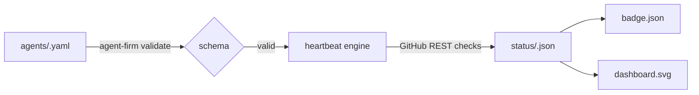

<div align="center">
  
</div>

<br/>

<div align="center">
  <h3>agent-firm</h3>
  <p><em>A GitHub-native agent firm: the heartbeat that proves it's alive.</em></p>
</div>

<div align="center">


[](https://github.com/mrodgersjs-web/rig-agent-firm/actions/workflows/ci.yml) [](https://github.com/mrodgersjs-web/rig-agent-firm/actions/workflows/heartbeat.yml)


</div>

<br/>

> Each repository owns one role. This repository owns the heartbeat: an hourly job that checks every agent's invariant through the GitHub API and regenerates a status JSON, badge, and dashboard with evidence.

## Install

This package is **not** published on PyPI; bare `pip install rig-agent-firm` will 404. From a fresh checkout:

```bash
git clone https://github.com/mrodgersjs-web/rig-agent-firm
cd rig-agent-firm
pip install -e '.[dev]'
```

(`pip install git+https://github.com/mrodgersjs-web/rig-agent-firm` is also supported.)

## Quick start

```bash
pip install -e '.[dev]'
agent-firm validate                      # check agents/*.yaml against the schema
scripts/smoke.sh                         # full engine run on recorded API fixtures, outputs verified
GITHUB_TOKEN=<token> agent-firm heartbeat --out out   # live run against GitHub (public repos need no scopes)
cat out/badge.json                       # shields endpoint; out/dashboard.svg and out/status/*.json sit beside it
```

`agent-firm heartbeat` flags: `--only a,b`, `--fixtures DIR` (replay recorded responses), `--record DIR` (save live ones), `--now ISO`, `--fail-on-offline`. `agent-firm render --status out/status --out out` rebuilds the badge and dashboard from existing status files.

## How it works

<sub align="center">agents/*.yaml spec &rarr; validator &rarr; heartbeat engine (GitHub REST API) &rarr; status/*.json &rarr; badge.json + dashboard.svg</sub>



1. **Spec**: `agents/<name>.yaml` (named for the agent's role) declares role, boundary, trigger, SLA, a one-line `invariant`, and machine `checks`. `agent-firm validate` rejects missing fields, unknown check types or params, bad repo slugs, and duplicates.
2. **Checks**: each check runs against the agent's repo on its default branch:

   | Type | Passes when |
   | :-- | :-- |
   | `file_exists` (`path`, optional `executable`) | the file is in the branch's git tree (executable = mode 100755) |
   | `workflow_success` (`workflow`, optional `max_age_hours`) | the latest completed run on the default branch concluded `success` within the window (default `sla_hours`) |
   | `release_exists` (optional `max_age_hours`) | the repo has a latest published release |
   | `commit_within` (optional `hours`) | the default branch has a commit newer than the window |

3. **Status**: one `status/<name>.json` per agent: `status` (`online` all checks pass, `offline` any check definitively fails or the repo is missing, `unknown` the API could not answer), per-check `detail`, and evidence (`run_url`, `sha`, `evidence_at`, `checked_at`). Legacy keys are kept; `schema_version` is 2.
4. **Firm status**: `online` if all agents are online, `offline` if any is offline, `degraded` if some are unknown. `badge.json` is a shields endpoint (`N/M online`); `dashboard.svg` shows one card per agent with results and evidence.
5. **Workflow**: `heartbeat.yml` runs hourly, runs the engine with the workflow's own `GITHUB_TOKEN`, and commits `status/`, `badge.json` and `dashboard.svg` to the `heartbeat` branch. `ci.yml` runs ruff, pytest and `scripts/smoke.sh` on every push and pull request.

A red badge is honest, not an error: a failing check reports what it saw. An agent whose smoke workflow last succeeded 770 hours ago is `offline` even though that run was green.

## The fleet

| Agent | Repository | What it does | Verify |
| :-- | :-- | :-- | :-- |
| Verifier | [proof-studio](https://github.com/mrodgersjs-web/proof-studio) | Catch false "done" with signed ProofPackets | smoke script + `smoke.yml` run |
| Operator | [jake-studio](https://github.com/mrodgersjs-web/jake-studio) | Run closed-loop operator sessions | smoke script + `smoke.yml` run |
| Fleet | [mesh-studio](https://github.com/mrodgersjs-web/mesh-studio) | Probe, boot, and recover nodes | smoke script + `smoke.yml` run |
| Builder | [rigforge](https://github.com/mrodgersjs-web/rigforge) | Deterministic build and proof scaffolding | smoke script + `smoke.yml` run |
| Strategist | [fde-portfolio](https://github.com/mrodgersjs-web/fde-portfolio) | Discovery → eval → handoff playbooks | smoke script + `smoke.yml` run |
| Governor | [doctrine](https://github.com/mrodgersjs-web/doctrine) | Rules agents load before acting | smoke script + `smoke.yml` run |

<sup>Each agent is declared in <code>agents/&lt;name&gt;.yaml</code> (one naming everywhere: the spec file, the status file and <code>--only</code> all use the role name; <code>repo</code> and <code>dept</code> name the repository it stewards) and bound by <a href="./CONSTITUTION.md"><code>CONSTITUTION.md</code></a>.</sup>

## Why it exists

- **The badge is proof, not decoration**: regenerated hourly from API checks, with the run URL and commit SHA behind each result
- **One repo, one role**: no agent's responsibilities overlap with another's
- **Forkable and GitHub-native**: copy the repo, edit the specs, enable Actions (PyYAML is the only dependency)

<details>
<summary><strong>Fork this firm</strong></summary>

<br/>

See [`CONSTITUTION.md`](./CONSTITUTION.md) for the full fork-and-instantiate guide: copy the repository, edit `agents/*.yaml` (run `agent-firm validate`), enable Actions and push (the workflow creates the `heartbeat` branch on first run), then point your profile README at the generated badge.

</details>

## Documentation

| Resource | Description |
| :-- | :-- |
| [`agents/`](./agents/) | Per-agent specs, named by role |
| [`CONSTITUTION.md`](./CONSTITUTION.md) | Fork-and-instantiate guide |
| [`agent_firm/`](./agent_firm/) · [`tests/`](./tests/) | Package · tests and recorded fixtures |
| [`heartbeat.yml`](.github/workflows/heartbeat.yml) · [CHANGELOG.md](CHANGELOG.md) | Hourly heartbeat (writes back to `heartbeat` branch) · release history |

## What it proves

Checks a reader can run:

1. `agent-firm validate` - every spec satisfies the schema (fields, check types, one repo, one role).
2. `pytest -q` - the engine's rules are exercised against recorded API fixtures, including stale-run, failed-run, missing-release and outage cases.
3. `bash scripts/smoke.sh` - a full fixture run writes 6 status files, the badge reads `4/6 online`, and the dashboard parses as SVG.

## Development

```bash
pip install -e '.[dev]'
ruff check .
pytest -q --cov=agent_firm
scripts/smoke.sh
```

## Contributing and security

See [CONTRIBUTING.md](CONTRIBUTING.md) and [SECURITY.md](SECURITY.md). Report
security issues to security@rodgersintelligence.com, not in a public issue.

## Roadmap

Not built yet: checks beyond the four types above (the specs' `queue_depth_metric`, `last_action_metric` and `claim` fields are documentation only), offline alerting, and the `mcp/server.py` results server integration. A spec's `heartbeat_cron` is documentation; the real schedule is the cron line in `heartbeat.yml`.

---

<div align="center"><sub>Built by Mike Rodgers · Forward Deployed Engineer · <a href="https://rodgersintelligence.com">rodgersintelligence.com</a></sub></div>
